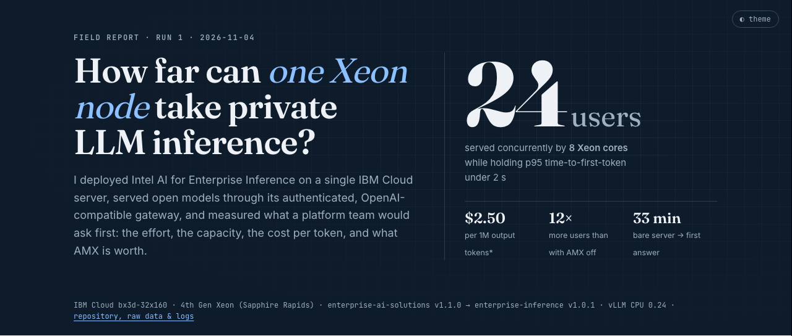
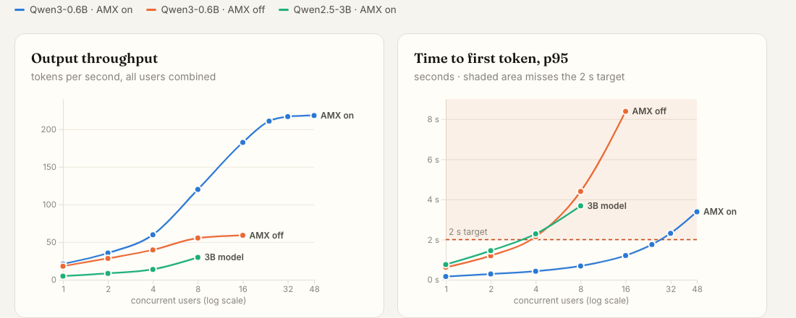
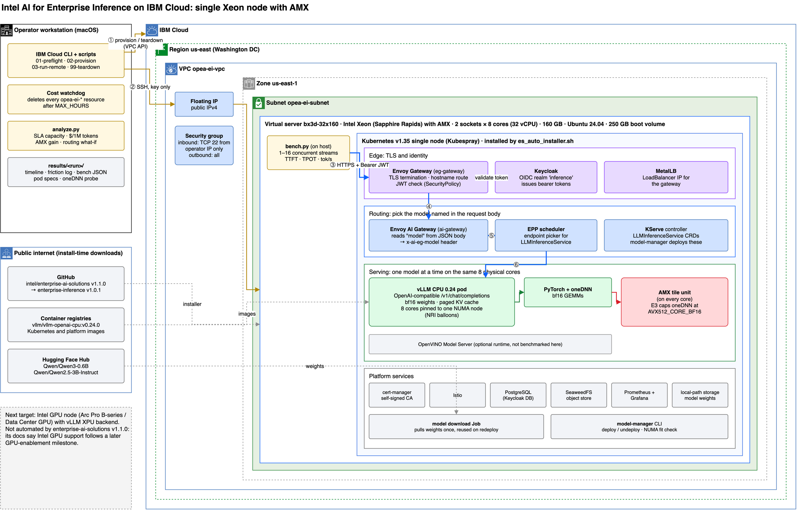

<h1 align="center">Private LLM inference on one Intel Xeon node</h1>

<p align="center">
A measured, reproducible deployment of <a href="https://github.com/intel/enterprise-inference">Intel AI for Enterprise Inference</a> on IBM Cloud:<br>
deployment effort, SLA capacity, cost per token, and what Intel AMX contributes.
</p>

<p align="center">
<a href="https://abh2050.github.io/private-inference-on-intel/"><b>Interactive results page →</b></a>
&nbsp;·&nbsp; <a href="results/20261103-2026/summary.md">Raw results</a>
&nbsp;·&nbsp; <a href="logs/operator-log.md">Run log</a>
</p>

<p align="center"><a href="https://abh2050.github.io/private-inference-on-intel/"></a></p>

## In one minute

- **24 concurrent users** on 8 Xeon cores (Qwen3-0.6B), with p95 time to first token under 2 s and every request succeeding.
- **$2.50 per million output tokens** at that load, at an estimated $1.90 per server-hour.
- **AMX is worth 12× the capacity.** With AMX disabled on the same cores, only 2 users stay within the target. Throughput is up to 3.1× higher with it.
- **33 minutes of automation** from a bare server to an authenticated, OpenAI-compatible endpoint answering correctly. The install ran 468 Ansible tasks with none failing.
- **Six small deployment observations**, each paired with a suggested improvement, and four ideas for what to build next.

## The problem

Teams moving LLM inference onto their own infrastructure, for cost, data privacy, or air-gap reasons, have to answer four questions before committing hardware:

| Question | What was measured |
|---|---|
| **Effort.** How long from an empty machine to a working, authenticated endpoint? | Timed install with every step logged |
| **Capacity.** How many users can one node serve before latency becomes unacceptable? | Concurrency sweep from 1 to 48 users |
| **Economics.** What does a million output tokens cost at that load? | Measured throughput × server price |
| **Hardware value.** How much of the result comes from Intel AMX? | The same run with AMX disabled |

The service target was fixed before the run: **p95 time to first token ≤ 2 s, at least 10 output tokens/s per user, and no failed requests.**

## Results

All runs used the same 8 physical cores (one NUMA node), a ~600-token prompt, and 128 output tokens. Every request went through the authenticated gateway, and every request succeeded.

<p align="center"></p>

### Capacity and cost: Qwen3-0.6B with AMX

| Users | Output tok/s | TTFT p95 | Tok/s per user | $ / 1M tokens | Within target |
|---:|---:|---:|---:|---:|:---:|
| 1 | 21.0 | 0.16 s | 22.0 | 25.13 | ✅ |
| 4 | 59.8 | 0.43 s | 16.6 | 8.83 | ✅ |
| 8 | 119.9 | 0.69 s | 18.5 | 4.40 | ✅ |
| 16 | 182.4 | 1.21 s | 15.6 | 2.89 | ✅ |
| **24** | **210.7** | **1.76 s** | **12.6** | **2.50** | ✅ |
| 32 | 216.7 | 2.31 s | 10.3 | 2.44 | — |
| 48 | 218.2 | 3.39 s | 5.5 | 2.42 | — |

Throughput saturates near 217 tokens/s at about 30 users, and TTFT is the first limit reached. Cost per token falls 10× between 1 and 24 users because the server costs the same per hour at any load. Running continuously, the node costs about $1,390 a month and can produce about 550 million output tokens at its 24-user operating point.

### What AMX contributes

Same model, same cores; the only change was `ONEDNN_MAX_CPU_ISA=AVX512_CORE_BF16` on the pod. oneDNN, probed inside each pod, confirms the kernel that ran: `brg_matmul:avx10_1_512_amx` with AMX and `brg_matmul:avx512_core_bf16` without it.

| Users | Tok/s, AMX on | Tok/s, AMX off | Gain | TTFT p95, on → off |
|---:|---:|---:|---:|---:|
| 1 | 21.0 | 18.0 | 1.2× | 0.16 → 0.62 s |
| 4 | 59.8 | 39.6 | 1.5× | 0.43 → 2.15 s |
| 8 | 119.9 | 55.4 | 2.2× | 0.69 → 4.40 s |
| 16 | 182.4 | 59.0 | 3.1× | 1.21 → 8.39 s |

Decode is limited by memory bandwidth, so a single user sees little difference. Prefill is compute-bound and dominates under load, which is where the matrix unit pays off: **24 users at $2.50 per million tokens with AMX, against 2 users at $18.58 without it.**

### A larger model

Qwen2.5-3B-Instruct answered correctly. On 8 cores it delivered 5.2 tokens/s to a single user and peaked at 29.7 tokens/s across 8 users, so at this size the target needs more cores per replica or tensor parallelism across both sockets.

## From request to token

| # | Component | What happens | What it determines |
|---|---|---|---|
| 1 | Envoy Gateway | TLS termination and Keycloak JWT validation; no token returns HTTP 401 | Access control |
| 2 | Envoy AI Gateway | Reads `"model"` from the JSON body and selects that model's route | Multi-model serving on one endpoint |
| 3 | EPP scheduler | Picks a serving endpoint for the `LLMInferenceService` | Load placement |
| 4 | vLLM | Tokenizes and joins the running batch (continuous batching) | Queueing |
| 5 | vLLM prefill | All prompt tokens in one pass; bf16 matrix multiplies on AMX | **Time to first token** |
| 6 | vLLM decode | One token per step, reading weights and the paged KV cache | **Tokens/s per user** |
| 7 | Gateways | Tokens stream back as server-sent events | OpenAI compatibility |
| 8 | NRI balloons | Pin the pod to whole cores on one NUMA node | Predictable latency |

## Architecture

<p align="center"></p>

| Layer | Components |
|---|---|
| Infrastructure | IBM Cloud VPC · `bx3d-32x160`: 4th Gen Xeon (Sapphire Rapids) with AMX, 2 sockets × 8 cores, 160 GB · Ubuntu 24.04 |
| Cluster | Kubernetes v1.34 (Kubespray), single node |
| Edge and identity | Envoy Gateway · MetalLB · cert-manager · Keycloak |
| Routing | Envoy AI Gateway · EPP scheduler · KServe `LLMInferenceService` |
| Serving | vLLM CPU 0.24, OpenAI-compatible (OpenVINO Model Server also available) |
| CPU placement | NRI balloons, NUMA-aware |
| Platform | Istio · PostgreSQL · SeaweedFS · Prometheus · Grafana |

Pinned versions: `intel/enterprise-ai-solutions` v1.1.0 → `intel/enterprise-inference` v1.0.1. Diagram source: [`docs/architecture.drawio`](docs/architecture.drawio).

## Deployment experience

The core install was solid: 468 Ansible tasks with none failing, 49 pods healthy, and no restarts. NUMA-aware placement, the placement pre-flight check, and model routing all worked as designed. Six small observations account for the rest of the time, and each has a simple fix:

| Area | Observation | Suggested improvement |
|---|---|---|
| Getting started | The OPEA repository points to `intel/enterprise-inference`, which is installed through `intel/enterprise-ai-solutions`; reaching the quick start took a few hops | Link every README straight to the one quick start |
| Unattended installs | `configure` asks for `[y/N]` confirmation, which waits in SSH or CI sessions; `--force` skips it | Show `--force` in the quick start, or name it when no terminal is attached |
| Validation coverage | `validate inference` stops at `nfd`, which has no `validate.yaml` in v1.1.0; the inference components after it all passed when validated individually | Skip components without a validate task and report per component |
| Scripting the token helper | `get-keycloak-token.sh` leaves a RETURN trap set, which stops callers running `set -u` | Clear the trap on return, or add a print-token command |
| Swapping models | `undeploy` returns while the pod still holds its pinned cores, so an immediate `deploy` fails pre-flight | Add `undeploy --wait` |
| Measuring against an SLA | Turning metrics into SLA capacity and cost per token took a separate load generator | A `model-manager bench` that reports against a stated target |

## Where Xeon fits, from this data

| Strong fit | Evidence |
|---|---|
| Small and mid-size models at interactive load | 24 users within target on 8 cores (measured) |
| Prefill-heavy work: RAG, summarization, classification | AMX adds up to 3.1× under load (measured) |
| Private and air-gapped deployments | Authenticated, OpenAI-compatible endpoint on owned hardware (measured) |
| Fleets that already run Xeon | Inference capacity without a new procurement (judgment) |

| Needs more cores or an accelerator | Evidence |
|---|---|
| 3B+ models for interactive users on a few cores | 5.2 tokens/s for one user on 8 cores (measured) |
| Loads past saturation | Throughput flat beyond ~30 users on 8 cores (measured) |

## What to build next

1. **A one-command evaluation path.** A single-node install that never prompts, validates each component, and ends by printing a working `curl`. *Target:* first answer in under 15 minutes.
2. **SLA reporting in model-manager.** `model-manager bench --sla ttft=2s,tps=10` would report capacity, TTFT, TPOT, and cost per million tokens into the existing Grafana. *Target:* every deployment ships with a recorded SLA capacity.
3. **A capacity planner.** Given a model and an SLA, recommend cores, replicas, and tensor parallelism, using the core inventory NRI pre-flight already has. *Target:* predictions within 15% of measured capacity.
4. **SLA-aware routing in the AI gateway.** Route each request to the smallest model that passes an evaluation set for its task. Measured throughput suggests a 70/30 split would cut cost by about 60%, which the evaluation would need to confirm.

## Method and scope

| Experiment | What was done |
|---|---|
| E1, deployment effort | Timed each phase on a fresh server; logged every retry and manual step |
| E2, capacity | Qwen3-0.6B at 1, 2, 4, 8, 16, 24, 32, and 48 concurrent users |
| E3, AMX | E2 repeated with AMX disabled in oneDNN |
| E4, model size | Qwen2.5-3B-Instruct at 1, 2, 4, and 8 users |
| E5, routing | Blended cost calculated from E2 and E4 throughput |

Cost per million output tokens = hourly price ÷ (output tokens/s × 3600) × 10⁶.

Scope and limits:
- One server and one run per configuration.
- The load generator ran on the same server.
- Costs use an estimated rate; IBM's partial billing for the run implies about $2/hour.
- Xeon only. Intel accelerators, such as Gaudi 3 on IBM Cloud, are candidates for a follow-up run.

## Reproduce

You need an IBM Cloud account and the IBM Cloud CLI. A full run takes about two hours of server time, roughly $3.

```bash
ibmcloud login --sso
./01-preflight.sh                  # read-only account and capacity checks
CONFIRM=yes ./02-provision.sh      # server plus a 4-hour auto-delete watchdog
./03-run-remote.sh                 # AMX check, timed install, experiments E1–E4
./03-run-remote.sh collect         # results and logs to results/<timestamp>/
python3 analyze.py results/<timestamp> --usd-per-hour <rate>
python3 docs/build_site.py results/<timestamp>
CONFIRM=yes ./99-teardown.sh       # deletes everything and verifies nothing is left
```

[RUNBOOK.md](RUNBOOK.md) has step-by-step detail and pass criteria.

<details>
<summary>Repository layout</summary>

```text
docs/                    results page (GitHub Pages), architecture diagram, previews
results/20261103-2026/   run 1: benchmarks, oneDNN probes, pod specs, install and session logs
logs/operator-log.md     every action during run 1, in order
env.sh                   region, profile, pinned versions, cost limits
01-preflight.sh … 99-teardown.sh   provision, run, collect, tear down
node/                    on-server scripts: hardware check, timed install, experiments, load generator
analyze.py               SLA capacity, cost per token, AMX ratio, routing calculation
```
</details>

The scripts are provided as-is. Intel components are Apache 2.0, and model weights come from Hugging Face under their own licenses.
